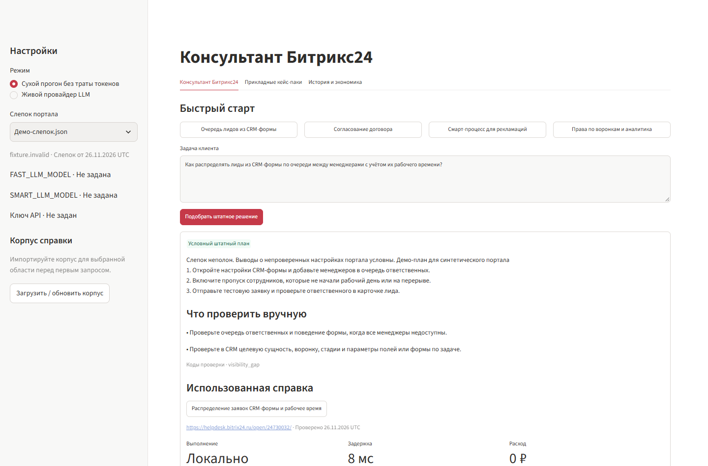
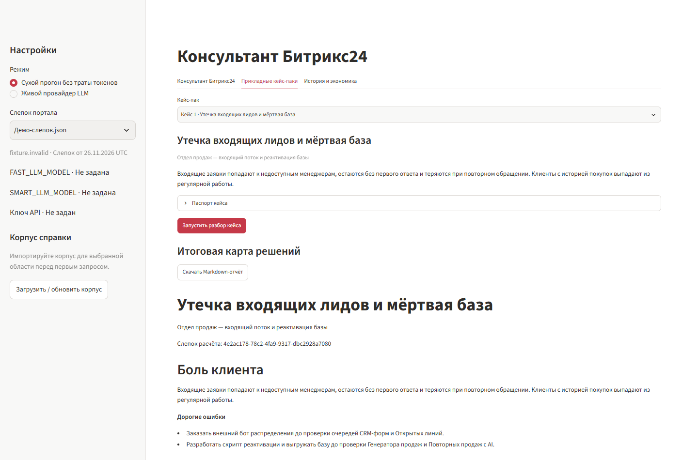
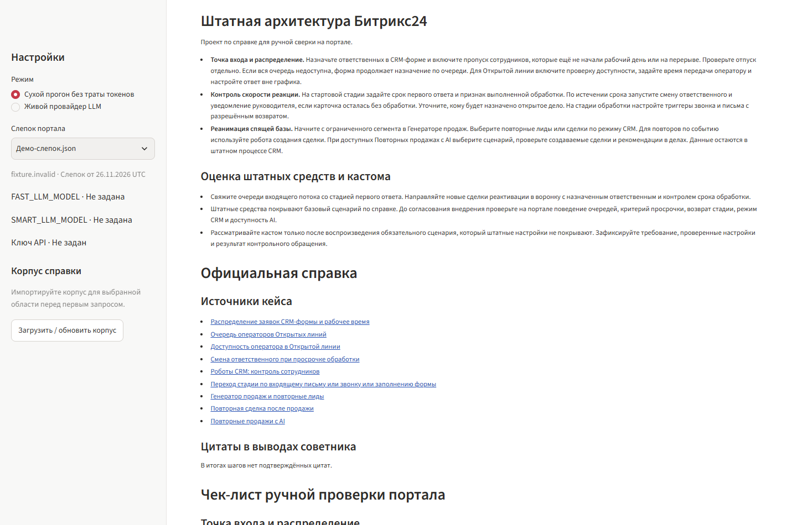
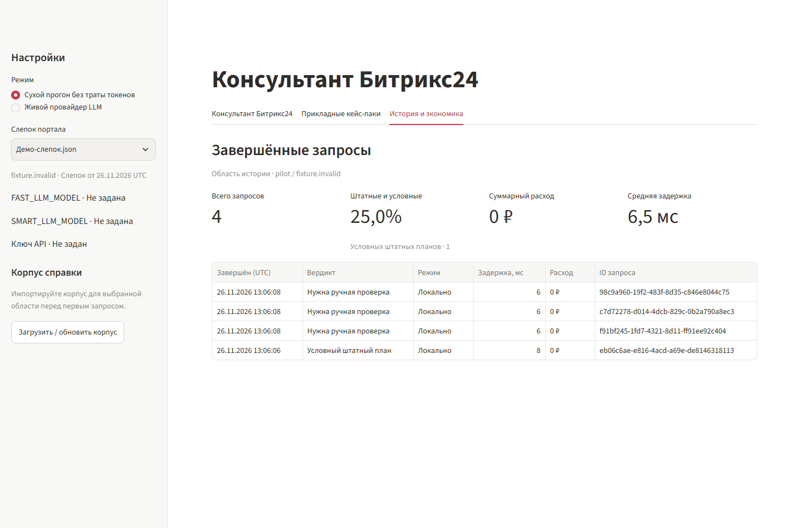

# b24-native-advisor

Локальный советник по внедрению Битрикс24. Помогает сократить объём заказной разработки, внешних интеграций и их сопровождения, когда задачу можно решить настройкой CRM, смарт-процессов, роботов и триггеров, дизайнера бизнес-процессов, ролей или штатной аналитики.

Советник сопоставляет read-only слепок метаданных портала с актуальными фрагментами официальной справки и REST-документации. На выходе — план внедрения с источниками и пунктами ручной сверки. API, интеграция или кастомная разработка предлагаются только при подтверждённом `native_gap` — документированном разрыве между требованием и штатными возможностями. Изменения на портале выполняет администратор.

## Консультации и кейс-паки

В локальном интерфейсе Streamlit (`apps/advisor_ui.py`) можно задать один вопрос или разобрать готовый кейс. Со слепком советник учитывает наблюдения о настройках портала. Без слепка при достаточном покрытии актуальной справкой он формирует условный план с чек-листом сверки. При недостатке доказательств результат — `undetermined` с указанием причины.

Во вкладке «История и экономика» видны завершённые запуски, их вердикты и расчётный расход в рублях. Сухой прогон выполняется локально за 0 ₽. В сетевом режиме стоимость рассчитывается по заданным тарифам, а запуски с неизвестным расходом отмечаются отдельно.

| Кейс | Что разбирает советник | Что получает клиент в Markdown |
| --- | --- | --- |
| 01 · Утечка лидов и реактивация базы | Распределение входящих обращений, контроль первого ответа, повторные продажи | План маршрутизации лидов и реактивации базы с проверками очереди и сроков ответа |
| 02 · Согласование договоров | Генерация договора, согласование в БП, передача сделки в работу после оплаты | Схему согласования и чек-лист проверки стадий, задач и условия передачи в работу |
| 03 · Производство и рекламации | Смарт-процессы для закупок, производства и рекламаций, связанные со сделкой | Схему связей и этапов с проверками сроков, таймлайна и эскалации просрочек |
| 04 · Изоляция филиалов и аналитика | Ролевой доступ, запрет экспорта CRM и штатная аналитика по подразделениям | План настройки прав и чек-лист проверки экспорта и отчётов под ролями руководителей |

Отчёт скачивается из интерфейса и включает выводы по шагам, источники, наблюдения при наличии слепка и телеметрию запуска. [Кейс-паки](docs/cases) · [Веб-презентация проекта](docs/presentation.html)

### Интерфейс в работе

Кадры сняты в локальном сухом прогоне с синтетическим слепком и корпусом из 50 фрагментов.

**Консультация.** Подготовленный демо-ответ показывает условный план настройки CRM-формы, ручную сверку и цитату из справки.



**Кейс-пак №1.** Карта решений по трём шагам и кнопка скачивания Markdown-отчёта.



**Клиентский отчёт.** Штатная архитектура, оценка применимости и источники для сверки администратором.



**История и экономика.** Одна консультация и три шага кейса с вердиктами, задержкой и суммарным расходом 0 ₽.



## Архитектура и надёжность

| Слой | Ответственность |
| --- | --- |
| `core/` | Строгие DTO Pydantic v2, шлюз моделей, поиск по корпусу и SQLite WAL |
| `modules/portal_audit/` | Сбор метаданных и фиксация пробелов видимости |
| `modules/advisor/` | Маршрутизация, сопоставление доказательств и проверка заключения |
| `apps/` | Интерфейс Streamlit, запуск кейс-паков и экспорт отчётов |
| `ops/runners/` | CLI для сбора и сверки слепка, импорта корпуса, пилота и бенчмарка |
| `docs/knowledge/` | 50 фрагментов официальной справки и REST-документации с датами проверки |

- **Read-only аудит.** Единый диспетчер разрешает пять REST-методов: `method.get`, `crm.type.list`, `crm.category.list`, `crm.status.list` и `crm.item.fields`. Лимит — 2 запроса в секунду на портал. Эффективные роли, штатные роботы, бизнес-процессы и настройки аналитики сверяются в интерфейсе портала.
- **Проверяемые доказательства.** По умолчанию поиск отбирает источники, проверенные за последние 30 дней. Код проверяет ID цитат и наблюдений, подставляет URL только из исходных доказательств и отклоняет ссылки, вставленные моделью в текст рекомендации. Для расширения требуется совпадение с документированным `native_gap`. Смысловое соответствие выводов проверяется на размеченных кейсах.
- **Модели и данные.** `FAST_LLM_MODEL` классифицирует вопрос, `SMART_LLM_MODEL` сопоставляет доказательства и формирует заключение. Ответ проходит строгую валидацию. Слепки и история разделены по тенанту и порталу в локальной SQLite WAL. Секреты и содержимое карточек исключены из журналов и входа моделей. Рублёвая телеметрия учитывает расход по стадиям.

**Проверено 26 ноября 2026 года:** 152 автотеста, Ruff и mypy прошли. Сухой бенчмарк совпал с разметкой в **11 из 11** кейсов при расходе 0 ₽.

## Быстрый старт

Команды для PowerShell из корня проекта. Требуются Python 3.14 для приведённых команд и SQLite 3.37+ с поддержкой JSON.

```powershell
py -3.14 -m pip install "pydantic>=2,<3" "python-dotenv>=1,<2" "streamlit>=1.67,<2" "pytest>=8,<10" "ruff>=0.11,<1" "mypy>=1.15,<3"
if (-not (Test-Path .env)) { Copy-Item .env.example .env }
py -3.14 -m streamlit run apps/advisor_ui.py
```

Откройте приложение на `127.0.0.1:8501`, выберите «Без слепка портала» и сухой прогон. Нажмите «Загрузить / обновить корпус» в боковой панели, затем задайте вопрос или запустите кейс-пак. Повторите импорт при первом использовании каждой области и после обновления корпуса. Для CLI импорт выполняется в БД, заданную через `SQLITE_PATH`. [Локальный интерфейс](http://127.0.0.1:8501)

```powershell
py -3.14 -m ops.runners.knowledge_index --index --corpus docs/knowledge/bitrix24.json --portal-id portal.example
py -3.14 -m ops.runners.advisor_benchmark --dry-run

New-Item -ItemType Directory -Force .local | Out-Null
$env:PYTEST_DISABLE_PLUGIN_AUTOLOAD = '1'
py -3.14 -m pytest --basetemp .local/pytest_tmp
py -3.14 -m ruff check .
py -3.14 -m mypy .
```

Живой аудит запускается отдельно для согласованного портала. Порядок сбора слепка, настройки провайдера и тарифов описан в инструкции. [Эксплуатация](docs/operations.md) · [Контракты](docs/contracts.md) · [Статус проекта](docs/status.md)
